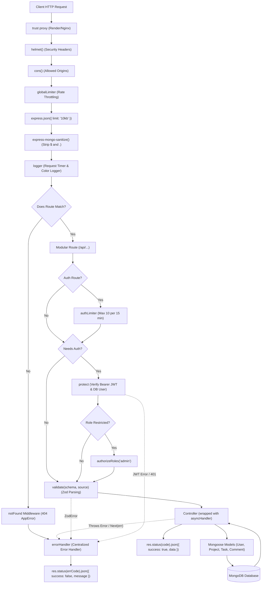
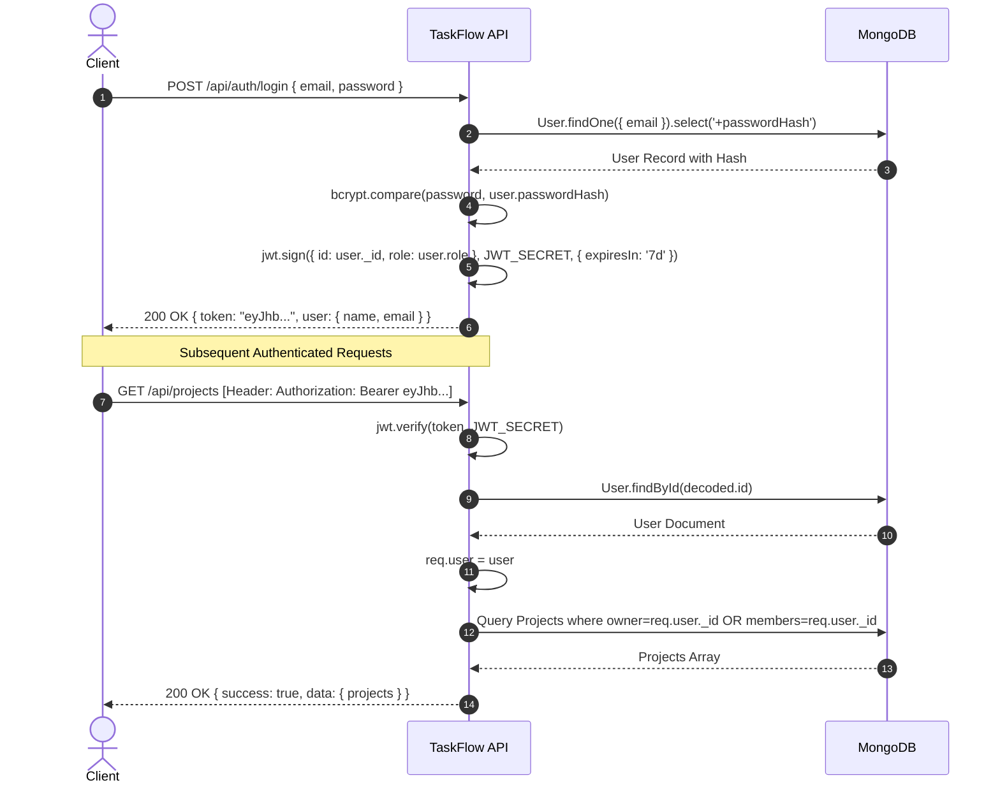
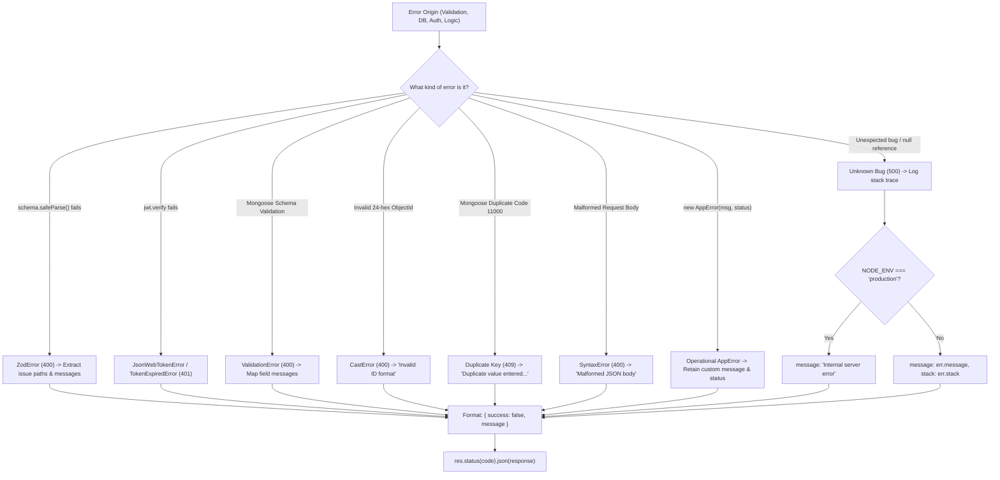

# TaskFlow Backend Engineering Study Guide

Welcome to the comprehensive backend architecture study guide for TaskFlow. This guide is curated specifically for software engineers and learners looking to master Node.js, Express, MongoDB, security, authentication, and production API design.

---

## Table of Contents
1. [Request Lifecycle Diagram](#1-request-lifecycle-diagram)
2. [Folder & File Reading Order](#2-folder--file-reading-order)
3. [Authentication & Authorization Deep Dive](#3-authentication--authorization-deep-dive)
4. [Endpoint Authorization Matrix](#4-endpoint-authorization-matrix)
5. [Error Handling Flow Diagram](#5-error-handling-flow-diagram)
6. [20 Backend Engineering Interview Questions & Answers](#6-20-backend-engineering-interview-questions--answers)
7. [10 "Break It" Hands-On Experiments](#7-10-break-it-hands-on-experiments)

---

## 1. Request Lifecycle Diagram

The diagram below maps the complete path of an incoming HTTP request through TaskFlow's middleware pipeline to the database and back to the client.

---

## 2. Folder & File Reading Order

To understand how this backend works from fundamentals to business logic, read the files in this sequence:

| Step | File | Purpose & Architectural Significance |
| :---: | :--- | :--- |
| **1** | `src/config/env.js` | **Configuration**: Validates environment variables with Zod at process startup. Fails fast if mandatory secrets are missing. |
| **2** | `src/config/db.js` | **Data Connection**: Initializes Mongoose connection to MongoDB and handles fatal connection errors. |
| **3** | `src/utils/AppError.js` | **Error Modeling**: Operational error class distinguishing anticipated errors (e.g. 404, 400) from unexpected runtime bugs. |
| **4** | `src/utils/asyncHandler.js` | **Async Control**: Higher-order function eliminating `try/catch` boilerplate across all controllers. |
| **5** | `src/utils/paginationHelper.js` | **Query Sanitization**: Safely clamps `page` and `limit` to prevent denial-of-service memory exhaustion. |
| **6** | `src/middleware/errorHandler.js` | **Global Error Normalizer**: Transforms Mongoose, Zod, and JWT errors into unified JSON error shapes. |
| **7** | `src/middleware/notFound.js` | **404 Catch-All**: Routes unmatched endpoints safely to the global error handler. |
| **8** | `src/middleware/logger.js` | **Observability**: Intercepts HTTP response `finish` events to log colored latency and status metrics. |
| **9** | `src/middleware/rateLimiters.js` | **DDoS Mitigation**: Implements tiered rate limiting for general traffic and sensitive auth routes. |
| **10** | `src/middleware/validate.js` | **Input Gatekeeper**: Factory middleware verifying incoming `body`, `query`, or `params` against Zod schemas. |
| **11** | `src/models/User.js` | **Identity Model**: Stores user identities with `select: false` on password hashes. |
| **12** | `src/models/Project.js` | **Workspace Model**: Defines collaborative project boundaries, owners, and members. |
| **13** | `src/models/Task.js` | **Entity Model**: Manages task states, priorities, assignments, and due dates. |
| **14** | `src/models/Comment.js` | **Collaboration Model**: Comment thread entries linked to tasks. |
| **15** | `src/middleware/auth.js` | **Authentication Barrier**: Extracts Bearer token, verifies JWT signature, and checks user existence in DB. |
| **16** | `src/middleware/authorizeRoles.js` | **RBAC Enforcement**: Restricts access based on user role (`admin` vs `user`). |
| **17** | `src/controllers/authController.js` | **Identity Logic**: Register and login workflows using `bcryptjs` and `jsonwebtoken`. |
| **18** | `src/controllers/projectController.js` | **Workspace Business Logic**: Ownership checks, membership verification, and cascading deletions. |
| **19** | `src/controllers/taskController.js` | **Task Operations**: Creation, multi-field filtering, sorting, pagination, and ownership checks. |
| **20** | `src/controllers/commentController.js` | **Discussion Logic**: Threaded discussions restricted to project team members. |
| **21** | `src/app.js` | **Application Composition**: Assembles the Express middleware pipeline in exact security order. |
| **22** | `src/server.js` | **Bootstrap**: Listens on the configured port, handles uncaught exceptions, and triggers graceful shutdown. |

---

## 3. Authentication & Authorization Deep Dive

### A. Password Hashing with bcryptjs
- **Why not SHA256 or MD5?** SHA256 and MD5 are general-purpose cryptographic hash functions designed to be as fast as possible (gigahashes per second on GPUs). For passwords, fast is disastrous because attackers can compute billions of candidate passwords per second.
- **bcrypt's design**: bcrypt incorporates a salt (random data concatenated to the password before hashing) to defend against rainbow table lookups. Additionally, it implements a configurable work factor (`saltRounds`, default `10`), making hashing computationally expensive and resistant to brute-force attacks.
- **`select: false` Invariant**: The `passwordHash` field in `src/models/User.js` has `select: false`. When queries like `User.find()` or `User.findById()` are executed, Mongoose automatically strips `passwordHash` from the projection unless explicitly overridden via `.select('+passwordHash')`.

### B. JWT Token Lifecycle

---

## 4. Endpoint Authorization Matrix

The table below outlines who can call each endpoint and which middleware protects it:

| # | Endpoint | Method | Required Access | Enforcing Middleware |
| :-: | :--- | :---: | :--- | :--- |
| **1** | `/health` | `GET` | Public | None |
| **2** | `/api/auth/register` | `POST` | Public | `authLimiter`, `validate(registerSchema)` |
| **3** | `/api/auth/login` | `POST` | Public | `authLimiter`, `validate(loginSchema)` |
| **4** | `/api/users/me` | `GET` | Authenticated | `protect` |
| **5** | `/api/users` | `GET` | Admin only | `protect`, `authorizeRoles('admin')` |
| **6** | `/api/projects` | `POST` | Authenticated | `protect`, `validate(createProjectSchema)` |
| **7** | `/api/projects` | `GET` | Authenticated | `protect` |
| **8** | `/api/projects/:id` | `GET` | Member / Owner | `protect`, `validate(params)`, controller member check |
| **9** | `/api/projects/:id` | `PATCH` | Project Owner | `protect`, `validate(params)`, `validate(update)`, owner check |
| **10** | `/api/projects/:id` | `DELETE` | Owner or Admin | `protect`, `validate(params)`, owner / admin check |
| **11** | `/api/projects/:id/members` | `POST` | Project Owner | `protect`, `validate(params)`, `validate(addMember)`, owner check |
| **12** | `/api/projects/:id/tasks` | `POST` | Project Member | `protect`, `validate(params)`, `validate(createTask)`, member check |
| **13** | `/api/projects/:id/tasks` | `GET` | Project Member | `protect`, `validate(params)`, `validate(query)`, member check |
| **14** | `/api/tasks/:id` | `PATCH` | Creator / Assignee | `protect`, `validate(params)`, `validate(updateTask)`, creator/assignee check |
| **15** | `/api/tasks/:id` | `DELETE` | Creator / Owner | `protect`, `validate(params)`, creator / project owner check |
| **16** | `/api/tasks/:id/comments` | `POST` | Project Member | `protect`, `validate(params)`, `validate(createComment)`, member check |

---

## 5. Error Handling Flow Diagram

---

## 6. 20 Backend Engineering Interview Questions & Answers

### Q1: Why do we use ES Modules (`import/export`) instead of CommonJS (`require`)?
**Answer**: ES Modules (ESM) are the official ECMAScript standard for JavaScript modularity. ESM enables static code analysis, efficient tree-shaking, native browser interop, and asynchronous top-level `await`. In Node.js LTS, ESM is first-class when `"type": "module"` is configured in `package.json`.

### Q2: What is the purpose of `asyncHandler`?
**Answer**: Express 4 route handlers do not automatically capture unhandled promise rejections. If an async controller throws without an explicit `try/catch`, the request can hang or crash the process. `asyncHandler` wraps the async function in `Promise.resolve(fn(req, res, next)).catch(next)`, guaranteeing that any uncaught error is forwarded directly into the Express error middleware pipeline.

### Q3: What distinguishes operational errors from programming bugs?
**Answer**: Operational errors (`AppError.isOperational = true`) represent anticipated, normal conditions that can occur during valid operation—such as invalid user input (400), expired JWTs (401), or missing resources (404). Programming bugs are unintended defects (e.g., `TypeError: Cannot read property of undefined`) that indicate software defects. Marking errors operational allows the global error handler to safely return error messages to clients while masking unexpected bugs behind generic 500 responses.

### Q4: Why is `express-mongo-sanitize` positioned after `express.json()` and before routes?
**Answer**: `express.json()` parses the raw incoming byte stream into JavaScript objects on `req.body`. If `express-mongo-sanitize` ran before `express.json()`, `req.body` would still be `undefined` and malicious keys would bypass sanitization. Placing it immediately after body parsing strips any key starting with `$` or containing `.` before controllers or validators ever see it.

### Q5: How does NoSQL injection work and how does TaskFlow prevent it?
**Answer**: In MongoDB, query objects accept operators like `{"$ne": null}` or `{"$gt": ""}`. If an unvalidated login request receives `{"email": {"$ne": null}, "password": "..."}`, an un-sanitized MongoDB query might match the first user in the database without matching their actual email. TaskFlow defends against this in two layers:
1. `express-mongo-sanitize` strips keys starting with `$` from input.
2. Zod schemas strictly assert that `email` is a primitive string (`z.string().email()`), rejecting any remaining empty object with HTTP 400.

### Q6: Why do we return 404 instead of 403 when a user accesses a project they do not belong to?
**Answer**: Returning `403 Forbidden` informs an attacker that a resource with that ID exists, leaking sensitive business intelligence. Returning `404 Not Found` conceals the resource's existence entirely.

### Q7: Why should passwords never be hashed with plain MD5 or SHA-256?
**Answer**: MD5 and SHA-256 are designed for ultra-high throughput. Modern consumer GPUs can compute tens of billions of SHA-256 hashes per second, making dictionary and brute-force attacks trivial. bcrypt is an intentionally slow, adaptive hash function with work factor controls and built-in salting.

### Q8: What is the difference between Authentication and Authorization?
**Answer**: Authentication is identity verification ("Who are you?"), handled in TaskFlow by `protect` via JWT verification. Authorization is permission verification ("What are you allowed to do?"), handled by `authorizeRoles`, project ownership checks, and task membership rules.

### Q9: Why is `passwordHash` marked with `select: false` in the Mongoose schema?
**Answer**: It acts as a fail-safe defense in depth. Developers frequently run `User.find()` or `User.findById()` and return the document. Marking `select: false` ensures that even if an engineer writes `res.json(user)`, the password hash is excluded from the query projection at the database engine level.

### Q10: How does `jwt.verify()` differ from `jwt.decode()`?
**Answer**: `jwt.decode()` only base4-decodes the payload without cryptographic verification—anyone can forge a decoded payload. `jwt.verify()` recalculates the cryptographic signature using the secret key (`JWT_SECRET`) and compares it against the token's signature, guaranteeing that neither the payload nor header has been modified.

### Q11: Why is rate limiting crucial for `/api/auth` endpoints?
**Answer**: Authentication endpoints are the primary targets of credential stuffing and brute-force dictionary attacks. A dedicated limiter (`authLimiter`, 10 requests per 15 minutes) dramatically throttles attack volume, rendering automated password guessing impractical.

### Q12: Why do we set `app.set('trust proxy', 1)`?
**Answer**: In production deployments (such as Render, Heroku, or behind an AWS ALB or NGINX), the Node app runs behind a reverse proxy. The proxy terminates SSL and forwards requests over HTTP, appending the client's real IP address to the `X-Forwarded-For` header. Enabling `trust proxy` tells Express to read the real client IP from the first proxy hop rather than recording the proxy's internal IP for rate limiting and logging.

### Q13: What is the risk of un-clamped pagination parameters?
**Answer**: If a user submits `?limit=10000000`, the MongoDB query would attempt to load millions of documents into Node.js V8 memory simultaneously, causing buffer allocations to spike and triggering out-of-memory (OOM) crashes. `parsePagination` clamps `limit` between 1 and 100.

### Q14: Why do we use sequential awaits instead of a transaction for cascading deletes in this project?
**Answer**: Multi-document transactions in MongoDB require a replica set or sharded cluster configuration and impose significant locking and memory overhead. For applications where eventual consistency or idempotent retry is acceptable, sequential awaits (`Comment.deleteMany -> Task.deleteMany -> Project.findByIdAndDelete`) provide simpler architecture without replica set prerequisites.

### Q15: How does Helmet enhance HTTP security?
**Answer**: Helmet sets crucial HTTP response headers:
- `X-Content-Type-Options: nosniff`: Prevents MIME-type sniffing.
- `Strict-Transport-Security` (HSTS): Enforces HTTPS connections.
- `X-Frame-Options: SAMEORIGIN`: Defends against Clickjacking attacks.
- `Content-Security-Policy`: Restricts unauthorized script execution.

### Q16: Why should error stack traces be hidden in production?
**Answer**: Stack traces reveal internal directory structures, library versions, database connection parameters, and exact line numbers where logic failed. Attackers exploit these implementation details to locate known vulnerabilities. TaskFlow suppresses `stack` in production and only displays it in `development`.

### Q17: What is the purpose of `process.on('unhandledRejection')` and `process.on('uncaughtException')`?
**Answer**: When an unexpected error escapes JavaScript error handlers, the process enters an unstable, unpredictable state where memory leaks or hung socket connections can occur. Listening to these events allows the application to log fatal errors with stack traces, close active database and network connections gracefully, and exit with code 1 so process managers (like PM2, Docker, or Kubernetes) can restart a clean instance.

### Q18: How does Zod's `safeParse` differ from `parse`?
**Answer**: `parse()` throws an exception synchronously if validation fails. `safeParse()` returns a discriminated union result object `{ success: true, data }` or `{ success: false, error }`. This allows the validation middleware to inspect errors cleanly and pass `result.error` down through `next(error)` without unhandled exception noise.

### Q19: Why do we use `mongodb-memory-server` for automated tests instead of a real shared MongoDB?
**Answer**: `mongodb-memory-server` spins up a dedicated, isolated MongoDB binary entirely in RAM. Tests run in complete isolation with zero network latency, zero database conflicts between local developers or CI pipelines, and zero risk of corrupting development or staging databases.

### Q20: What is the benefit of defining route documentation blocks (`WHAT`, `WHO`, `FAILS`)?
**Answer**: Self-documenting code reduces onboarding friction. Developers immediately understand the route's intent, authentication requirements, and error modes directly above the endpoint definition without having to switch contexts to external wiki pages or stale documentation.

---

## 7. 10 "Break It" Hands-On Experiments

Try these experiments in your local development environment to observe how TaskFlow's defensive mechanisms respond:

### Experiment 1: NoSQL Injection Attempt
- **Action**: Call `POST /api/auth/login` with `{"email": {"$ne": null}, "password": "any"}`.
- **Expected Outcome**: `express-mongo-sanitize` strips `$ne`, reducing `email` to `{}`. Zod detects that `email` is not a valid email string and returns `400 Bad Request` with an explanatory message.

### Experiment 2: Missing Required JWT Secret
- **Action**: In `.env`, comment out `JWT_SECRET` and restart the server (`npm start`).
- **Expected Outcome**: `src/config/env.js` halts immediately with exit code 1, logging that `JWT_SECRET is required`. The server refuses to boot in an insecure state.

### Experiment 3: Over-sized Request Body DoS
- **Action**: Send a 1MB payload to `POST /api/projects`.
- **Expected Outcome**: `express.json({ limit: '10kb' })` immediately aborts the connection with HTTP `413 Payload Too Large`, preventing memory exhaustion.

### Experiment 4: Exceeding Authentication Rate Limit
- **Action**: Execute 11 rapid requests to `POST /api/auth/login` with incorrect credentials.
- **Expected Outcome**: The 11th request triggers `authLimiter` and returns `429 Too Many Requests` with `{ success: false, message: "Too many authentication attempts..." }`.

### Experiment 5: Unauthorized Cross-Project Task Creation
- **Action**: Register User A and User B. User A creates Project A. User B attempts `POST /api/projects/<ProjectA_ID>/tasks`.
- **Expected Outcome**: The endpoint detects that User B is not listed in `project.members` and returns `403 Forbidden`.

### Experiment 6: Project Existence Probing
- **Action**: As User B, attempt `GET /api/projects/<ProjectA_ID>`.
- **Expected Outcome**: Instead of returning `403 Forbidden`, the API returns `404 Not Found`, denying the attacker confirmation of the project's existence.

### Experiment 7: Tampered JWT Signature
- **Action**: Copy a valid JWT from a login response, alter the last 4 characters of the token string, and send it in `Authorization: Bearer <tampered-token>`.
- **Expected Outcome**: `jwt.verify` fails signature validation and returns `401 Unauthorized` with `{ success: false, message: "Invalid token" }`.

### Experiment 8: Malformed MongoDB ObjectId
- **Action**: Call `GET /api/projects/12345-not-an-objectid`.
- **Expected Outcome**: `projectParamsSchema` checks the regex `/^[0-9a-fA-F]{24}$/` and returns `400 Bad Request` with `Invalid ObjectId`. The request never touches MongoDB.

### Experiment 9: Malformed JSON Syntax
- **Action**: Send raw broken JSON: `{"title": "Unclosed string}` to `POST /api/projects`.
- **Expected Outcome**: Express's body parser throws a `SyntaxError`. The global `errorHandler` catches it and returns `400 Bad Request` with `{ success: false, message: "Malformed JSON body" }`.

### Experiment 10: Assigning Non-Member to a Task
- **Action**: Create a project with User A. Attempt to create a task assigning User B (who has not been added as a member).
- **Expected Outcome**: The task controller validates assignee membership and returns `400 Bad Request` with `"Assigned user must be a member of the project"`.
